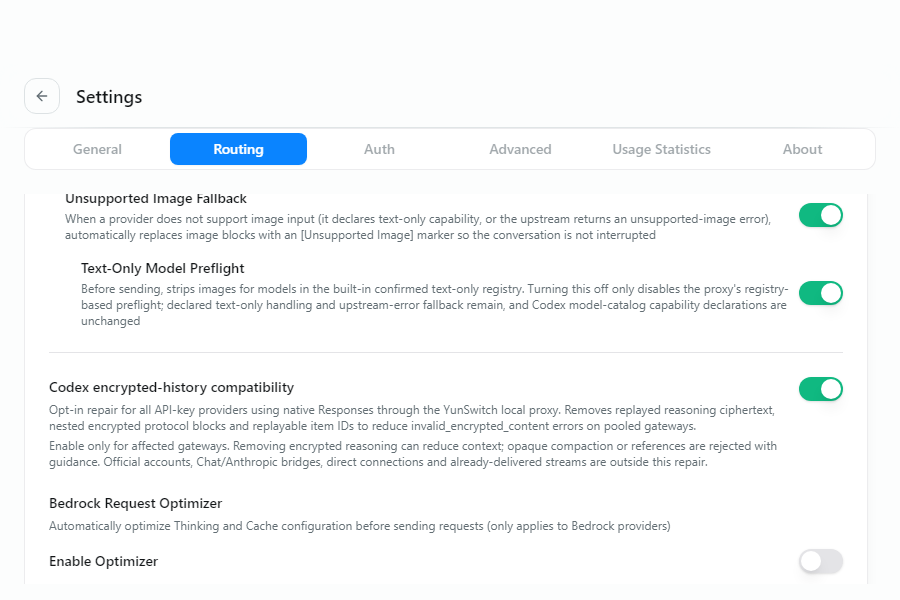

<div align="center">

# YunSwitch

Configuration and local routing for AI coding tools, across providers and models.

[](LICENSE)
[](https://tauri.app/)
[](https://github.com/yunhanhai/yunswitch/releases/tag/v3.20.1-yunswitch.8)

English | [中文](README_ZH.md) | [日本語](README_JA.md) | [Deutsch](README_DE.md)

[Download and quick start](#download-and-quick-start) · [Features](#features) · [Documentation](#documentation) · [Roadmap](docs/DEVELOPMENT-ROADMAP.md)

[Gitee](https://gitee.com/yunhanhai/yunswitch) · [GitHub](https://github.com/yunhanhai/yunswitch) · [Project notes](docs/PROJECT.md) · [Changelog](CHANGELOG.md)

</div>

> **Project support · [艺の公益站](https://ultrarouter.org/sign-up?aff=KnwD)**
>
> Thank you to 艺の公益站 for supporting YunSwitch. The link above is a referral signup link.

## About

YunSwitch manages provider configurations for Claude Code, Codex, Gemini CLI and other coding tools. Its local proxy organizes routes, maps model names and handles recoverable request failures.

**Independently maintained by yunhanhai**, this project continues development from [CC Switch v3.20.1](https://github.com/farion1231/cc-switch). Routing groups, model aliases across providers, configuration conversion and request recovery are its main additions. See the [project notes](docs/PROJECT.md) and [source ledger](docs/PROVENANCE.md) for provenance and licensing.

## Download and quick start

**Next release in preparation:** [`3.20.1-yunswitch.9`](docs/releases/3.20.1-yunswitch.9.md) will bring shared Claude Code / Codex channels, linking existing configurations, redacted request diagnostics and build-source information to a new Windows package. Its new-package and `.8` upgrade checks are still pending; the public downloads below remain `.8`.

Current release: **`3.20.1-yunswitch.8` Windows x64 prerelease**, available as an MSI installer and portable ZIP.

| Platform      | Downloads and verification                                                                                                                                                                                                                   |
| ------------- | -------------------------------------------------------------------------------------------------------------------------------------------------------------------------------------------------------------------------------------------- |
| Windows x64   | [GitHub download](https://github.com/yunhanhai/yunswitch/releases/tag/v3.20.1-yunswitch.8) · [Gitee download](https://gitee.com/yunhanhai/yunswitch/releases/tag/v3.20.1-yunswitch.8); installation, upgrade from `.7` and uninstall checked |
| macOS / Linux | [Source CI](https://github.com/yunhanhai/yunswitch/actions/runs/43592579771) passed; independent packages and installation acceptance are pending                                                                                            |
| ARM64         | No independent packages or installation acceptance yet                                                                                                                                                                                       |

Version `.8` coordinates rate-limit recovery attempts, respects extended shared cooldowns and bounds queueing and waiting. **1569 local proxy regression tests** and **[88 Windows runtime checks](https://github.com/yunhanhai/yunswitch/actions/runs/43592678793)** passed. See the [release record](docs/releases/3.20.1-yunswitch.8.md) for the evidence.

Windows packages are unsigned and automatic updates are disabled. Download updates from this project's releases above; read the [migration guide](docs/MIGRATION-YUNSWITCH.md) before reusing existing configurations.

1. Install the MSI, or extract the portable ZIP and start YunSwitch.
2. Add the provider's API URL, key and models. For routing or protocol bridging, start the local proxy and enable takeover for the relevant client.
3. Configure groups, aliases and retry preferences as needed, then inspect the route, status and usage after a request.

## Features

Inherited capabilities include configuration management for Claude Code, Claude Desktop, Codex, Gemini CLI, Grok Build, OpenCode, OpenClaw and Hermes Agent, plus provider switching, MCP, Prompts, Skills, sessions, usage tracking, a local proxy and basic failover. See the [user manual](docs/user-manual/en/README.md) for client-specific capabilities and requirements.

| Area                        | Main additions                                                                                                                  | Details                                                           |
| --------------------------- | ------------------------------------------------------------------------------------------------------------------------------- | ----------------------------------------------------------------- |
| Routing groups              | Per-app provider groups, enable/disable controls, ordering, effective route previews and health indicators                      | [Routing groups](docs/routing-groups.en.md)                       |
| Model aliases               | Map logical models to provider-specific names on failover; suggest aliases from existing mappings                               | [Alias design and boundaries](docs/model-alias-routing-design.md) |
| Gemini routing              | Apply aliases in model URL paths and record the selected provider and actual upstream model                                     | [Development record](docs/RELEASE-NOTES-P1-P6.md)                 |
| Model catalogs              | Dynamic catalogs, caching and mapping assistance                                                                                | [User manual](docs/user-manual/en/README.md)                      |
| Provider conversion         | Convert third-party Claude configurations to Codex, preserve source models, prevent duplicates and probe direct-mode candidates | [Conversion notes](docs/claude-to-codex-conversion.md)            |
| Request recovery            | Bounded 429 waits, shared cooldowns and coordinated recovery; optional same-provider retries, failover and circuit status       | [Recovery behavior](docs/CODEX-STREAM-RECOVERY.md)                |
| Codex history compatibility | Optional native Responses gateway repair, limited to protocol containers and protected state references                         | [Switch and scope](docs/CODEX-RESPONSES-COMPATIBILITY.md)         |
| Maintenance                 | Preserve configuration fields and comments, isolate development/test directories and verify languages and loopback scenarios    | [Contributing](CONTRIBUTING.md)                                   |

The Responses ↔ Anthropic bridge core comes from upstream. This project adds configuration conversion, model handling, operating guards and integration verification. Further open-source integrations follow the [roadmap](docs/DEVELOPMENT-ROADMAP.md).

## Preview

Codex encrypted-history compatibility settings from the Windows x64 `.8` release acceptance. The switch is off by default; it was enabled for this check.



## Usage boundaries

- Aliases are configured mappings and provider presets are starting points. Actual models, plans and long sessions need verification for each combination.
- Same-provider retries are off by default and capped at 10. 429 waiting is a separate opt-in with count and duration limits. Delivered output or tool activity prevents automatic replay; native stateful Codex requests retain single-send protection.
- Codex encrypted-history compatibility is off by default. It applies to API-key native Responses through the local proxy and can reduce replayed reasoning context. Official accounts/OAuth, protocol bridges and direct connections have different boundaries.
- Claude → Codex bridging requires the local proxy. Direct-mode candidate selection does not verify actual Responses support.

Read [request recovery](docs/CODEX-STREAM-RECOVERY.md) and [Codex compatibility](docs/CODEX-RESPONSES-COMPATIBILITY.md) for settings and behavior.

## Documentation

| Task                                      | Guide                                                                                                                                                                                                      |
| ----------------------------------------- | ---------------------------------------------------------------------------------------------------------------------------------------------------------------------------------------------------------- |
| Configure clients and providers           | [User manual](docs/user-manual/en/README.md)                                                                                                                                                               |
| Manage routes and model mappings          | [Routing index](docs/routing-groups.index.md) · [Model aliases](docs/model-alias-routing-design.md)                                                                                                        |
| Convert existing provider configurations  | [Claude → Codex conversion](docs/claude-to-codex-conversion.md)                                                                                                                                            |
| Route across providers                    | [Kimi with Codex](docs/guides/codex-kimi-routing-guide-en.md) · [Claude with Codex](docs/guides/codex-claude-routing-guide-en.md) · [Codex with Claude Code](docs/guides/claude-codex-routing-guide-en.md) |
| Display models in Codex Desktop           | [Custom model visibility](docs/guides/codex-desktop-custom-model-visibility-en.md)                                                                                                                         |
| Understand rate limits and history issues | [Request recovery](docs/CODEX-STREAM-RECOVERY.md) · [Encrypted-history compatibility](docs/CODEX-RESPONSES-COMPATIBILITY.md)                                                                               |
| Migrate or upgrade                        | [Migration guide](docs/MIGRATION-YUNSWITCH.md) · [Current release record](docs/releases/3.20.1-yunswitch.8.md)                                                                                             |
| Review plans and provenance               | [Roadmap](docs/DEVELOPMENT-ROADMAP.md) · [Project notes](docs/PROJECT.md) · [Source ledger](docs/PROVENANCE.md)                                                                                            |

The [changelog](CHANGELOG.md) links to previous versions and their verification records. Upstream installation instructions in older manuals are historical references; use this project's releases for installation and updates. Some detailed development and compatibility documents are in Chinese.

## Development

| Tool          | Requirement                                                                      |
| ------------- | -------------------------------------------------------------------------------- |
| Node.js       | 22.12+; `.node-version` pins 22.12.0                                             |
| pnpm          | 10.12.3, pinned by `package.json`                                                |
| Rust          | Toolchain 1.95, rustfmt and clippy, pinned by `rust-toolchain.toml`              |
| Windows       | MSVC C++ Build Tools, Windows SDK and WebView2                                   |
| macOS / Linux | Corresponding [Tauri 2 prerequisites](https://v2.tauri.app/start/prerequisites/) |

```bash
git clone https://gitee.com/yunhanhai/yunswitch.git
cd yunswitch
corepack pnpm install --frozen-lockfile
corepack pnpm dev
```

You can also clone `https://github.com/yunhanhai/yunswitch.git`. When using Corepack, prefix the following pnpm commands with `corepack`.

| Command                                           | Purpose                                              |
| ------------------------------------------------- | ---------------------------------------------------- |
| `pnpm dev`                                        | Start Tauri desktop development                      |
| `pnpm dev:renderer`                               | Start the frontend; desktop APIs still require Tauri |
| `pnpm typecheck`                                  | Check TypeScript types                               |
| `pnpm test:unit`                                  | Run frontend unit tests                              |
| `pnpm build:renderer`                             | Build the frontend                                   |
| `pnpm build`                                      | Build the desktop application and packages           |
| `cargo test --manifest-path src-tauri/Cargo.toml` | Run backend tests                                    |

`pnpm dev` uses `YunSwitch Dev`, `~/.yunswitch-dev`, `yunswitch-dev://` and proxy port `15732`. Release builds use `YunSwitch`, `~/.yunswitch`, `yunswitch://` and port `15731`. Imported databases retain their configured ports. See the [migration guide](docs/MIGRATION-YUNSWITCH.md) before using existing data and [CONTRIBUTING.md](CONTRIBUTING.md) for the workflow.

## Contributing and next steps

The project currently has one maintainer. Use [Gitee Issues](https://gitee.com/yunhanhai/yunswitch/issues) or [GitHub Issues](https://github.com/yunhanhai/yunswitch/issues) for questions and suggestions. Read [CONTRIBUTING.md](CONTRIBUTING.md) for code contributions and [SECURITY.md](SECURITY.md) for security reports.

Request diagnostics and shared channels are implemented and have passed their separate source and build-only checks. The current task is to validate and publish `.9` with identifiable build sources, followed by focused form-draft protection and real-provider / long-session verification. The [roadmap](docs/DEVELOPMENT-ROADMAP.md) records their scope and acceptance criteria.

## Attribution and license

Thanks to [the upstream CC Switch project](https://github.com/farion1231/cc-switch), original author Jason Young, contributors and dependencies.

This project remains under **MIT**, preserving upstream copyright and permission notices and adding attribution for changes by yunhanhai. See [LICENSE](LICENSE) and the [source ledger](docs/PROVENANCE.md).
