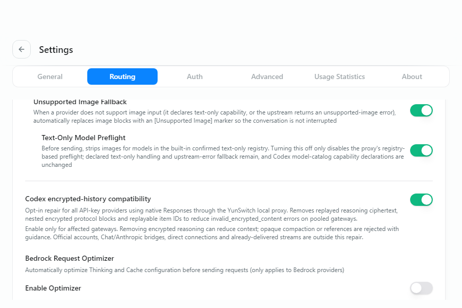

<div align="center">

# YunSwitch

Konfiguration und lokales Routing für KI-Coding-Werkzeuge, über mehrere Anbieter und Modelle.

[](LICENSE)
[](https://tauri.app/)
[](https://github.com/yunhanhai/yunswitch/releases/tag/v3.20.1-yunswitch.8)

[English](README.md) | [中文](README_ZH.md) | [日本語](README_JA.md) | Deutsch

[Download und Einstieg](#download-und-einstieg) · [Funktionen](#funktionen) · [Dokumentation](#dokumentation) · [Entwicklungsplan](docs/DEVELOPMENT-ROADMAP.md)

[Gitee](https://gitee.com/yunhanhai/yunswitch) · [GitHub](https://github.com/yunhanhai/yunswitch) · [Projektinformationen](docs/PROJECT.md) · [Änderungen](CHANGELOG.md)

</div>

> **Projektunterstützung · [艺の公益站](https://ultrarouter.org/sign-up?aff=KnwD)**
>
> Vielen Dank an 艺の公益站 für die Unterstützung von YunSwitch. Der obige Registrierungslink enthält einen Empfehlungscode.

## Über das Projekt

YunSwitch verwaltet Anbieter-Konfigurationen für Claude Code, Codex, Gemini CLI und weitere Coding-Werkzeuge. Der lokale Proxy organisiert Routen, ordnet Modelle zu und behandelt behebbare Anfragefehler.

Das Projekt wird **eigenständig von yunhanhai gepflegt** und basiert auf [CC Switch v3.20.1](https://github.com/farion1231/cc-switch). Routinggruppen, Modell-Aliase, Konfigurationsumwandlung und Anfragewiederherstellung gehören zu den Erweiterungen. Herkunft und Lizenzen stehen in den [Projektinformationen](docs/PROJECT.md) und im [Quellenverzeichnis](docs/PROVENANCE.md).

## Download und Einstieg

**Nächste Version in Vorbereitung:** [`3.20.1-yunswitch.9`](docs/releases/3.20.1-yunswitch.9.md) bündelt gemeinsame Kanäle für Claude Code und Codex, die Verknüpfung vorhandener Konfigurationen, bereinigte Anfragediagnosen und Informationen zur Build-Herkunft in einem neuen Windows-Paket. Die Prüfung dieses Pakets und des Upgrades von `.8` steht noch aus; die öffentlichen Downloads unten bleiben bei `.8`.

Aktuelle Version: **`3.20.1-yunswitch.8` als Windows-x64-Vorabversion**, mit MSI-Installer und portabler ZIP.

| Plattform     | Bezug und Prüfstand                                                                                                                                                                                                            |
| ------------- | ------------------------------------------------------------------------------------------------------------------------------------------------------------------------------------------------------------------------------ |
| Windows x64   | [GitHub](https://github.com/yunhanhai/yunswitch/releases/tag/v3.20.1-yunswitch.8) · [Gitee](https://gitee.com/yunhanhai/yunswitch/releases/tag/v3.20.1-yunswitch.8); Installation, Upgrade von `.7` und Deinstallation geprüft |
| macOS / Linux | [Quellcode-CI](https://github.com/yunhanhai/yunswitch/actions/runs/43592579771) erfolgreich; eigenständige Pakete und Installationsprüfung stehen aus                                                                          |
| ARM64         | Noch keine eigenständigen Pakete oder Installationsprüfung                                                                                                                                                                     |

Version `.8` koordiniert Wiederholungen nach Ratenlimits, berücksichtigt verlängerte gemeinsame Wartefristen und begrenzt Wartezeiten. **1569 lokale Proxy-Regressionstests** und **[88 Windows-Laufzeitprüfungen](https://github.com/yunhanhai/yunswitch/actions/runs/43592678793)** bestanden. Details enthält der [Veröffentlichungsnachweis](docs/releases/3.20.1-yunswitch.8.md).

Die Windows-Pakete sind nicht signiert; automatische Updates sind deaktiviert. Updates stehen auf den oben verlinkten Release-Seiten. Vor der Übernahme vorhandener Einstellungen die [Migrationsanleitung](docs/MIGRATION-YUNSWITCH.md) lesen.

1. MSI installieren oder die portable ZIP entpacken und YunSwitch starten.
2. API-URL, Schlüssel und Modelle des Anbieters eintragen. Für Routing oder Protokollumsetzung den lokalen Proxy und die Übernahme des jeweiligen Clients aktivieren.
3. Gruppen, Aliase und Wiederholungen bei Bedarf einstellen; anschließend die tatsächliche Route, den Status und den Verbrauch prüfen.

## Funktionen

Übernommen wurden die Konfigurationsverwaltung für Claude Code, Claude Desktop, Codex, Gemini CLI, Grok Build, OpenCode, OpenClaw und Hermes Agent sowie Anbieterwechsel, MCP, Prompts, Skills, Sitzungen, Verbrauchsanzeige, lokaler Proxy und grundlegendes Failover. Anforderungen je Client stehen im [englischen Benutzerhandbuch](docs/user-manual/en/README.md).

| Bereich                      | Erweiterungen dieses Projekts                                                                                       | Details                                                      |
| ---------------------------- | ------------------------------------------------------------------------------------------------------------------- | ------------------------------------------------------------ |
| Routinggruppen               | Anbieter je Anwendung gruppieren, aktivieren und sortieren; wirksame Route und Status anzeigen                      | [Routinggruppen](docs/routing-groups.en.md)                  |
| Modell-Aliase                | Logische Modellnamen auf anbieterspezifische Namen abbilden, auch beim Anbieterwechsel                              | [Entwurf und Grenzen](docs/model-alias-routing-design.md)    |
| Gemini-Routing               | Modellnamen im URL-Pfad mit Anbieterwahl und tatsächlichem Zielmodell abstimmen                                     | [Entwicklungsnotizen](docs/RELEASE-NOTES-P1-P6.md)           |
| Modellkatalog                | Dynamische Modelllisten, Cache und Zuordnungshilfen                                                                 | [Benutzerhandbuch](docs/user-manual/en/README.md)            |
| Claude → Codex               | Einstellungen umwandeln, Quellmodelle erhalten, Duplikate vermeiden und direkte Verbindungskandidaten prüfen        | [Konvertierung](docs/claude-to-codex-conversion.md)          |
| Anfragewiederherstellung     | Begrenztes Warten bei 429, gemeinsame Wartefristen, koordinierte Wiederholungen, Failover und Status                | [Wiederherstellung](docs/CODEX-STREAM-RECOVERY.md)           |
| Codex-Verlaufskompatibilität | Optionaler Schalter für verschlüsselte Verläufe bei nativen Responses; Zustandsreferenzen geschützt                 | [Schalter und Umfang](docs/CODEX-RESPONSES-COMPATIBILITY.md) |
| Pflege und Prüfung           | Konfigurationsfelder und Kommentare erhalten, Entwicklungs- und Testdaten trennen, Sprachen und Regressionen prüfen | [Beiträge](CONTRIBUTING.md)                                  |

Die Responses- und Anthropic-Protokollbrücke stammt aus dem Ursprungsprojekt. Hier kommen Konfigurationsumwandlung, Modellbehandlung, Betriebsbedingungen und Integrationsprüfungen hinzu. Weitere Integrationen folgen dem [Entwicklungsplan](docs/DEVELOPMENT-ROADMAP.md).

## Vorschau

Codex-Verlaufskompatibilität aus der Release-Prüfung von Windows x64 `.8`. Der Schalter ist standardmäßig aus; für diese Prüfung wurde er eingeschaltet.



## Nutzungsgrenzen

- Aliase sind konfigurierte Zuordnungen, Vorlagen dienen als Ausgangspunkt. Tatsächliche Modelle, Tarife und lange Sitzungen müssen je Kombination geprüft werden.
- Wiederholungen beim gleichen Anbieter sind standardmäßig aus und auf 10 begrenzt. Das Warten bei 429 ist separat zu aktivieren und zeitlich sowie nach Anzahl begrenzt. Nach Ausgabe oder Werkzeugaktivität wird nicht automatisch erneut gesendet; native zustandsgebundene Codex-Anfragen behalten den Schutz vor Mehrfachversand.
- Codex-Verlaufskompatibilität ist standardmäßig aus. Sie gilt für native Responses mit API-Schlüssel über den lokalen Proxy und kann den erneut übertragenen Denkverlauf reduzieren. Offizielle Konten/OAuth, Protokollbrücken und direkte Verbindungen haben eigene Grenzen.
- Die Claude-zu-Codex-Brücke benötigt den lokalen Proxy. Die Auswahl direkter Verbindungskandidaten bestätigt noch keine tatsächliche Responses-Unterstützung.

Einstellungen und Verhalten erläutern [Wiederherstellung](docs/CODEX-STREAM-RECOVERY.md) und [Codex-Kompatibilität](docs/CODEX-RESPONSES-COMPATIBILITY.md).

## Dokumentation

| Aufgabe                           | Anleitung                                                                                                                                                                                               |
| --------------------------------- | ------------------------------------------------------------------------------------------------------------------------------------------------------------------------------------------------------- |
| Clients und Anbieter einrichten   | [Englisches Benutzerhandbuch](docs/user-manual/en/README.md)                                                                                                                                            |
| Routen und Modelle verwalten      | [Routinggruppen](docs/routing-groups.en.md) · [Modell-Aliase](docs/model-alias-routing-design.md)                                                                                                       |
| Einstellungen umwandeln           | [Claude → Codex](docs/claude-to-codex-conversion.md)                                                                                                                                                    |
| Andere Anbieter nutzen            | [Kimi mit Codex](docs/guides/codex-kimi-routing-guide-en.md) · [Claude mit Codex](docs/guides/codex-claude-routing-guide-en.md) · [Codex mit Claude Code](docs/guides/claude-codex-routing-guide-en.md) |
| Modelle in Codex Desktop anzeigen | [Eigene Modelle](docs/guides/codex-desktop-custom-model-visibility-en.md)                                                                                                                               |
| Migrieren und aktualisieren       | [Migration](docs/MIGRATION-YUNSWITCH.md) · [Veröffentlichungsnachweis](docs/releases/3.20.1-yunswitch.8.md)                                                                                             |
| Pläne und Herkunft prüfen         | [Entwicklungsplan](docs/DEVELOPMENT-ROADMAP.md) · [Projektinformationen](docs/PROJECT.md) · [Quellenverzeichnis](docs/PROVENANCE.md)                                                                    |

Einige technische Unterlagen sind auf Chinesisch oder Englisch. Die [Änderungsübersicht](CHANGELOG.md) führt frühere Versionen und Prüfnachweise auf. Installationshinweise des Ursprungsprojekts in älteren Handbüchern dienen als historische Referenz; für dieses Projekt die eigenen Releases verwenden.

## Entwicklung aus dem Quellcode

Benötigt werden Node.js 22.12+, pnpm 10.12.3, Rust 1.95 und die [Tauri-2-Systemvoraussetzungen](https://v2.tauri.app/start/prerequisites/) für das Betriebssystem. Details stehen in [CONTRIBUTING.md](CONTRIBUTING.md).

```bash
git clone https://gitee.com/yunhanhai/yunswitch.git
cd yunswitch
corepack pnpm install --frozen-lockfile
corepack pnpm dev
```

Alternativ von `https://github.com/yunhanhai/yunswitch.git` klonen. Die Entwicklung verwendet `YunSwitch Dev` und `~/.yunswitch-dev`, die Veröffentlichung `YunSwitch` und `~/.yunswitch`.

## Beiträge und nächste Schritte

Das Projekt wird derzeit von einer Person gepflegt. Fragen und Vorschläge über [Gitee Issues](https://gitee.com/yunhanhai/yunswitch/issues) oder [GitHub Issues](https://github.com/yunhanhai/yunswitch/issues) einreichen. Codebeiträge beschreibt [CONTRIBUTING.md](CONTRIBUTING.md), Sicherheitsberichte [SECURITY.md](SECURITY.md).

Anfragediagnosen und gemeinsame Kanäle sind implementiert und haben ihre jeweiligen Quellcode- und Build-only-Prüfungen bestanden. Zunächst wird `.9` mit erkennbarer Build-Herkunft geprüft und veröffentlicht. Danach folgen gezielte Verbesserungen am Schutz von Formularentwürfen sowie Prüfungen mit echten Anbietern und langen Sitzungen. Umfang und Abnahmekriterien stehen im [Entwicklungsplan](docs/DEVELOPMENT-ROADMAP.md).

## Herkunft und Lizenz

Vielen Dank an [das ursprüngliche CC Switch](https://github.com/farion1231/cc-switch), Jason Young, Mitwirkende und Abhängigkeiten.

Die **MIT**-Lizenz bleibt bestehen. Ursprüngliche Copyright- und Erlaubnishinweise werden erhalten und um die Änderungen von yunhanhai ergänzt. Siehe [LICENSE](LICENSE) und [Quellenverzeichnis](docs/PROVENANCE.md).
