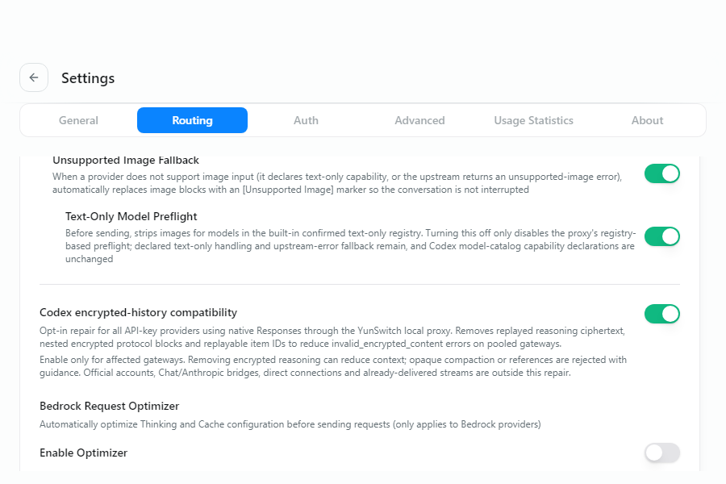

<div align="center">

# YunSwitch

AI コーディングツールの設定とローカルルーティングを、複数のプロバイダーとモデルで管理。

[](LICENSE)
[](https://tauri.app/)
[](https://github.com/yunhanhai/yunswitch/releases/tag/v3.20.1-yunswitch.8)

[English](README.md) | [中文](README_ZH.md) | 日本語 | [Deutsch](README_DE.md)

[ダウンロードとクイックスタート](#ダウンロードとクイックスタート) · [主な機能](#主な機能) · [ドキュメント](#ドキュメント) · [開発計画](docs/DEVELOPMENT-ROADMAP.md)

[Gitee](https://gitee.com/yunhanhai/yunswitch) · [GitHub](https://github.com/yunhanhai/yunswitch) · [プロジェクト情報](docs/PROJECT.md) · [変更履歴](CHANGELOG.md)

</div>

> **プロジェクト支援 · [艺の公益站](https://ultrarouter.org/sign-up?aff=KnwD)**
>
> YunSwitch を支援してくださる艺の公益站に感謝します。上記は紹介コード付きの登録リンクです。

## このプロジェクトについて

YunSwitch は Claude Code、Codex、Gemini CLI などのプロバイダー設定を管理します。ローカルプロキシでルートやモデル名を設定し、回復可能なリクエスト障害に対応します。

**yunhanhai が独立して保守**する、[CC Switch v3.20.1](https://github.com/farion1231/cc-switch) を基にした継続開発です。ルーティンググループ、モデルエイリアス、設定変換、リクエスト回復を追加・改善しています。出典とライセンスは[プロジェクト情報](docs/PROJECT.md)と[出典台帳](docs/PROVENANCE.md)に記録しています。

## ダウンロードとクイックスタート

**次のバージョンを準備中：**[`3.20.1-yunswitch.9`](docs/releases/3.20.1-yunswitch.9.md) では Claude Code / Codex 共通チャネル、既存設定の関連付け、機密情報を除いたリクエスト診断、ビルド元情報を新しい Windows パッケージに含めます。新パッケージと `.8` からのアップグレード検証は未完了のため、以下の公開ダウンロードは引き続き `.8` です。

現在のバージョン：**`3.20.1-yunswitch.8` Windows x64 プレビュー版**。MSI インストーラーとポータブル ZIP を公開しています。

| プラットフォーム | 入手方法と検証状況                                                                                                                                                                                                                       |
| ---------------- | ---------------------------------------------------------------------------------------------------------------------------------------------------------------------------------------------------------------------------------------- |
| Windows x64      | [GitHub](https://github.com/yunhanhai/yunswitch/releases/tag/v3.20.1-yunswitch.8) · [Gitee](https://gitee.com/yunhanhai/yunswitch/releases/tag/v3.20.1-yunswitch.8)。インストール、`.7` からのアップグレード、アンインストールを検証済み |
| macOS / Linux    | [ソース CI](https://github.com/yunhanhai/yunswitch/actions/runs/43592579771) は成功。独立パッケージとインストール検証は未提供                                                                                                            |
| ARM64            | 独立パッケージとインストール検証は未提供                                                                                                                                                                                                 |

`.8` はレート制限後の回復を順番に処理し、延長された共有待機期限と待機上限を守ります。**ローカルのプロキシ回帰テスト 1569 件**と **[Windows 実行検証 88 件](https://github.com/yunhanhai/yunswitch/actions/runs/43592678793)**に成功しました。詳細は[リリース記録](docs/releases/3.20.1-yunswitch.8.md)を参照してください。

Windows パッケージは未署名で、自動更新は無効です。更新には上記の公開パッケージを使用し、既存設定を使う前に[移行ガイド](docs/MIGRATION-YUNSWITCH.md)を確認してください。

1. MSI をインストールするか、ポータブル ZIP を展開して YunSwitch を起動します。
2. API URL、キー、モデルを登録します。ルーティングやプロトコル変換が必要な場合は、ローカルプロキシを起動し、対象クライアントの設定をプロキシ経由に切り替えます。
3. グループ、エイリアス、再試行設定を必要に応じて調整し、実際のルート、状態、使用量を確認します。

## 主な機能

上流の機能として Claude Code、Claude Desktop、Codex、Gemini CLI、Grok Build、OpenCode、OpenClaw、Hermes Agent の設定管理、プロバイダー切り替え、MCP、Prompts、Skills、セッション、使用量、ローカルプロキシと基本的なフェイルオーバーを引き継いでいます。クライアントごとの要件は[ユーザーマニュアル](docs/user-manual/ja/README.md)を参照してください。

| 機能                    | このリポジトリの主な改善                                               | 詳細                                                    |
| ----------------------- | ---------------------------------------------------------------------- | ------------------------------------------------------- |
| ルーティンググループ    | アプリごとにプロバイダーを整理し、順序変更、実効ルート、状態を表示     | [ルーティング](docs/routing-groups.ja.md)               |
| モデルエイリアス        | 論理モデル名を各プロバイダーのモデル名へ変換し、切り替え時にも適用     | [設計と範囲](docs/model-alias-routing-design.md)        |
| Gemini ルーティング     | URL 内のモデル名、選択プロバイダー、送信モデルを整合                   | [開発記録](docs/RELEASE-NOTES-P1-P6.md)                 |
| モデルカタログ          | 動的なモデル一覧、キャッシュ、マッピング補助                           | [マニュアル](docs/user-manual/ja/README.md)             |
| Claude → Codex 設定変換 | 元のモデルを保持し、重複作成を防止。直接接続候補も確認                 | [設定変換](docs/claude-to-codex-conversion.md)          |
| リクエスト回復          | 429 待機、共有期限と回復調整、有限の再試行、フェイルオーバーと状態表示 | [回復処理](docs/CODEX-STREAM-RECOVERY.md)               |
| Codex 履歴互換          | ネイティブ Responses の暗号化履歴互換スイッチ。状態参照を保護          | [スイッチと範囲](docs/CODEX-RESPONSES-COMPATIBILITY.md) |
| 保守と検証              | 設定とコメントの保持、開発・テスト環境の分離、多言語・回帰検証         | [貢献ガイド](CONTRIBUTING.md)                           |

Responses ↔ Anthropic のプロトコル変換基盤は上流の実装です。本リポジトリは設定変換、モデル処理、実行条件と統合検証を追加します。今後の統合は[開発計画](docs/DEVELOPMENT-ROADMAP.md)に沿って進めます。

## 画面プレビュー

Windows x64 `.8` のリリース検証で確認した Codex 暗号化履歴互換設定です。スイッチは初期設定では無効で、画面は検証時に有効にした状態です。



## 利用範囲

- エイリアスは設定上の対応付け、プリセットは設定の出発点です。実際のモデル、プラン、長いセッションは組み合わせごとの検証が必要です。
- 同じプロバイダーへの再試行は初期設定では無効、最大 10 回です。429 待機は別の設定で回数・時間に上限があります。出力やツール動作が始まった後は再送せず、状態を持つネイティブ Codex 要求は一度の送信に制限します。
- Codex 暗号化履歴互換は初期設定では無効です。API キーを使いローカルプロキシを通るネイティブ Responses が対象で、推論コンテキストが減る場合があります。公式アカウント/OAuth、プロトコル変換、直接接続の範囲は異なります。
- Claude → Codex のブリッジはローカルプロキシが必要です。直接接続候補の判定は Responses の動作検証ではありません。

詳細は[回復処理](docs/CODEX-STREAM-RECOVERY.md)と[Codex 互換](docs/CODEX-RESPONSES-COMPATIBILITY.md)を参照してください。

## ドキュメント

| 目的                           | ガイド                                                                                                                                                                                               |
| ------------------------------ | ---------------------------------------------------------------------------------------------------------------------------------------------------------------------------------------------------- |
| クライアントとプロバイダー設定 | [日本語マニュアル](docs/user-manual/ja/README.md)                                                                                                                                                    |
| ルートとモデル設定             | [ルーティング](docs/routing-groups.ja.md) · [モデルエイリアス](docs/model-alias-routing-design.md)                                                                                                   |
| 設定変換                       | [Claude → Codex](docs/claude-to-codex-conversion.md)                                                                                                                                                 |
| 他のプロバイダーを利用         | [Codex と Kimi](docs/guides/codex-kimi-routing-guide-en.md) · [Codex と Claude](docs/guides/codex-claude-routing-guide-en.md) · [Claude Code と Codex](docs/guides/claude-codex-routing-guide-en.md) |
| Codex Desktop のモデル表示     | [カスタムモデル](docs/guides/codex-desktop-custom-model-visibility-en.md)                                                                                                                            |
| 移行と更新                     | [移行ガイド](docs/MIGRATION-YUNSWITCH.md) · [リリース記録](docs/releases/3.20.1-yunswitch.8.md)                                                                                                      |
| 計画と出典                     | [開発計画](docs/DEVELOPMENT-ROADMAP.md) · [プロジェクト情報](docs/PROJECT.md) · [出典台帳](docs/PROVENANCE.md)                                                                                       |

詳細な技術資料の一部は中文または英語です。[変更履歴](CHANGELOG.md)に過去のバージョンと検証記録を保持しています。旧資料の上流インストール情報は履歴として参照し、本プロジェクトの更新にはここで公開したパッケージを使用してください。

## ソースから開発する

Node.js 22.12+、pnpm 10.12.3、Rust 1.95 と利用 OS の [Tauri 2 開発環境](https://v2.tauri.app/start/prerequisites/)を準備してください。詳細は[貢献ガイド](CONTRIBUTING.md)を参照してください。

```bash
git clone https://gitee.com/yunhanhai/yunswitch.git
cd yunswitch
corepack pnpm install --frozen-lockfile
corepack pnpm dev
```

GitHub からも `https://github.com/yunhanhai/yunswitch.git` をクローンできます。開発版は `YunSwitch Dev` と `~/.yunswitch-dev`、公開版は `YunSwitch` と `~/.yunswitch` を使用します。

## 参加と今後の計画

現在は一人で保守しています。[Gitee Issues](https://gitee.com/yunhanhai/yunswitch/issues) または [GitHub Issues](https://github.com/yunhanhai/yunswitch/issues)で問題や提案を受け付けます。コードの貢献は[貢献ガイド](CONTRIBUTING.md)、セキュリティ報告は[セキュリティ方針](SECURITY.md)を参照してください。

リクエスト診断と共通チャネルは実装済みで、各段階のソース検査と公開前パッケージ検証を完了しています。現在はビルド元を識別できる `.9` の検証と公開を進め、その後はフォームの編集中データ保護、実プロバイダーと長いセッションを個別に検証します。範囲と完了条件は[開発計画](docs/DEVELOPMENT-ROADMAP.md)を参照してください。

## 出典とライセンス

[上流 CC Switch](https://github.com/farion1231/cc-switch) の作者 Jason Young、コントリビューター、依存プロジェクトに感謝します。

**MIT** ライセンスを継続し、上流の著作権・許諾表示を保持して yunhanhai の変更に関する署名を追加しています。[LICENSE](LICENSE)と[出典台帳](docs/PROVENANCE.md)を参照してください。
