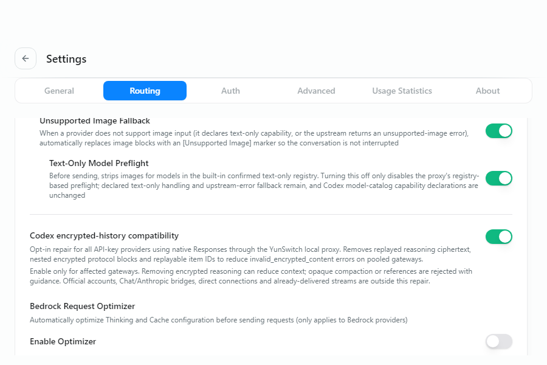

<div align="center">

# YunSwitch

AI 编程工具配置与路由管理，统一管理多供应商、多模型与本地代理。

[](LICENSE)
[](https://tauri.app/)
[](https://github.com/yunhanhai/yunswitch/releases/tag/v3.20.1-yunswitch.9)

[English](README.md) | 中文 | [日本語](README_JA.md) | [Deutsch](README_DE.md)

[下载与快速开始](#下载与快速开始) · [核心功能](#核心功能) · [文档导航](#文档导航) · [开发路线](docs/DEVELOPMENT-ROADMAP.md)

[Gitee](https://gitee.com/yunhanhai/yunswitch) · [GitHub](https://github.com/yunhanhai/yunswitch) · [项目说明](docs/PROJECT.md) · [更新记录](CHANGELOG.md)

</div>

> **项目支持 · [艺の公益站](https://ultrarouter.org/sign-up?aff=KnwD)**
>
> 感谢艺の公益站为 YunSwitch 提供支持。上方为推广注册链接。

## 项目介绍

YunSwitch 帮助你管理 Claude Code、Codex、Gemini CLI 等工具的供应商配置，并通过本地代理组织路由、映射模型和处理可恢复的请求故障。

本项目由 **yunhanhai 独立维护**，基于 [CC Switch v3.20.1](https://github.com/farion1231/cc-switch) 持续二次开发。路由分组、跨供应商模型别名、供应商配置转换及请求恢复增强属于本仓库的主要改进；代码来源与许可记录见[项目说明](docs/PROJECT.md)和[来源台账](docs/PROVENANCE.md)。

## 下载与快速开始

当前版本：**`3.20.1-yunswitch.9` Windows x64 预发布**，提供 MSI 安装版与免安装 ZIP。

| 平台          | 获取方式与验证状态                                                                                                                                                                                            |
| ------------- | ------------------------------------------------------------------------------------------------------------------------------------------------------------------------------------------------------------- |
| Windows x64   | [Gitee 下载](https://gitee.com/yunhanhai/yunswitch/releases/tag/v3.20.1-yunswitch.9) · [GitHub 下载](https://github.com/yunhanhai/yunswitch/releases/tag/v3.20.1-yunswitch.9)；安装、从 `.8` 升级与卸载已验收 |
| macOS / Linux | [源码 CI](https://github.com/yunhanhai/yunswitch/actions/runs/45871888586)通过，尚无独立安装包及安装验收                                                                                                      |
| ARM64         | 尚无独立安装包或安装验收                                                                                                                                                                                      |

本版支持一次维护 Claude Code / Codex 共享渠道及关联已有配置，包含脱敏请求诊断、请求预算、准确终态统计和构建来源。**1153 项前端测试**及 **[206 项 Windows 运行检查](https://github.com/yunhanhai/yunswitch/actions/runs/45871920781)**通过，包含从 `.8` 升级。完整证据见[发布说明](docs/releases/3.20.1-yunswitch.9.md)。

Windows 包尚未配置发布者签名，自动更新关闭。更新时请从上方本项目发布入口下载；使用旧配置前先阅读[数据迁移指南](docs/MIGRATION-YUNSWITCH.md)。

1. 下载 MSI 安装包，或解压免安装 ZIP 后启动 YunSwitch。
2. 添加供应商的 API 地址、密钥与模型；需要协议桥接或路由时，启动本地代理并启用对应客户端接管。
3. 按需配置路由分组、模型别名和重试策略，发起请求后查看实际路由、状态与用量。

## 核心功能

继承的基础能力包括 Claude Code、Claude Desktop、Codex、Gemini CLI、Grok Build、OpenCode、OpenClaw 和 Hermes Agent 的配置管理，以及供应商切换、MCP、Prompts、Skills、会话管理、用量统计、本地代理和基础故障转移。各客户端的具体能力与要求见[用户手册](docs/user-manual/zh/README.md)。

| 方向           | 本仓库的主要增强                                                                    | 使用说明                                                    |
| -------------- | ----------------------------------------------------------------------------------- | ----------------------------------------------------------- |
| 路由分组       | 按应用组织供应商，分组启停、组内排序、生效路由预览与健康状态                        | [路由分组](docs/routing-groups.md)                          |
| 模型别名       | 将逻辑模型映射到不同渠道的物理模型名，故障转移时同步切换；从已有映射生成归并建议    | [别名设计与边界](docs/model-alias-routing-design.md)        |
| Gemini 路由    | 同步处理 URL 路径中的模型别名、选路与实际发送模型的记录                             | [开发记录](docs/RELEASE-NOTES-P1-P6.md)                     |
| 模型目录       | 动态模型目录、缓存与模型映射辅助，减少手工填写                                      | [用户手册](docs/user-manual/zh/README.md)                   |
| 供应商转换     | Claude 第三方供应商转换为 Codex 配置，保留源模型、防止重复创建，并探测直连候选      | [转换说明](docs/claude-to-codex-conversion.md)              |
| 请求恢复       | 429 等待、共享冷却与恢复协调，同供应商有限重试、故障转移及熔断状态展示              | [恢复说明](docs/CODEX-STREAM-RECOVERY.md)                   |
| Codex 历史兼容 | 可选开关处理部分原生 Responses 网关的加密历史兼容问题，按协议容器清理并保护状态引用 | [兼容开关与适用范围](docs/CODEX-RESPONSES-COMPATIBILITY.md) |
| 维护与验证     | 保留配置字段与注释，隔离开发和测试目录，验证多语言及路由、转换回环场景              | [贡献指南](CONTRIBUTING.md)                                 |

Responses 与 Anthropic 协议桥接核心继承自上游；本仓库补充配置转换入口、模型处理、运行条件判断及整链验证。其他开源能力会按[开发路线](docs/DEVELOPMENT-ROADMAP.md)逐项整合。

## 界面预览

Windows x64 `.8` 发布验收中的 Codex 加密历史兼容设置。该开关默认关闭，图中为验收时启用后的状态。



## 使用边界

- 模型别名属于配置映射，供应商预设属于配置起点；真实模型、套餐和长会话需按实际组合验证。
- 同供应商重试默认关闭，最多 10 次；429 等待也需单独开启，并受次数和单次等待上限约束。已有输出或工具活动后不自动重放，原生状态型 Codex 请求保留一次发送保护。
- Codex 加密历史兼容默认关闭，适用于经过本地代理、使用 API Key 的原生 Responses 请求，可能减少可回放的推理上下文；官方账号/OAuth、跨协议路径和直接连接有不同边界。
- Claude → Codex 桥接需要本地路由。直连候选判断不等于实际 Responses 支持验证。

具体行为与设置入口见[请求恢复](docs/CODEX-STREAM-RECOVERY.md)和[Codex 兼容说明](docs/CODEX-RESPONSES-COMPATIBILITY.md)。

## 文档导航

| 你想做什么                  | 文档                                                                                                                                                                                                       |
| --------------------------- | ---------------------------------------------------------------------------------------------------------------------------------------------------------------------------------------------------------- |
| 配置客户端与供应商          | [用户手册](docs/user-manual/zh/README.md)                                                                                                                                                                  |
| 管理路由与模型映射          | [路由文档导航](docs/routing-groups.index.md) · [模型别名](docs/model-alias-routing-design.md)                                                                                                              |
| 转换已有供应商配置          | [Claude → Codex 配置转换](docs/claude-to-codex-conversion.md)                                                                                                                                              |
| 使用跨供应商路由            | [Codex 接入 Kimi](docs/guides/codex-kimi-routing-guide-zh.md) · [Codex 接入 Claude](docs/guides/codex-claude-routing-guide-zh.md) · [Claude Code 接入 Codex](docs/guides/claude-codex-routing-guide-zh.md) |
| 在 Codex Desktop 中显示模型 | [自定义模型显示](docs/guides/codex-desktop-custom-model-visibility-zh.md)                                                                                                                                  |
| 处理限流或历史兼容问题      | [请求恢复](docs/CODEX-STREAM-RECOVERY.md) · [加密历史兼容](docs/CODEX-RESPONSES-COMPATIBILITY.md)                                                                                                          |
| 迁移与升级                  | [数据迁移指南](docs/MIGRATION-YUNSWITCH.md) · [当前发布记录](docs/releases/3.20.1-yunswitch.9.md)                                                                                                          |
| 了解开发计划与来源          | [开发路线](docs/DEVELOPMENT-ROADMAP.md) · [项目说明](docs/PROJECT.md) · [来源台账](docs/PROVENANCE.md)                                                                                                     |

[更新记录](CHANGELOG.md)保留各版本变化与历史验证入口。旧手册和开发记录中的上游安装信息供历史参考，安装与更新以本项目实际发布说明为准。

## 开发与构建

环境版本以仓库配置为准：

| 工具          | 要求                                                               |
| ------------- | ------------------------------------------------------------------ |
| Node.js       | 22.12+；`.node-version` 固定为 22.12.0                             |
| pnpm          | 10.12.3，见 `package.json` 的 `packageManager`                     |
| Rust          | 1.95 工具链，含 rustfmt / clippy，见 `rust-toolchain.toml`         |
| Windows       | MSVC C++ Build Tools、Windows SDK、WebView2                        |
| macOS / Linux | 对应 [Tauri 2 系统依赖](https://v2.tauri.app/start/prerequisites/) |

```bash
git clone https://gitee.com/yunhanhai/yunswitch.git
cd yunswitch
corepack pnpm install --frozen-lockfile
corepack pnpm dev
```

GitHub 也可以作为克隆来源：`https://github.com/yunhanhai/yunswitch.git`。

常用命令（使用 Corepack 时，在 `pnpm` 前加 `corepack`）：

| 命令                                              | 用途                                |
| ------------------------------------------------- | ----------------------------------- |
| `pnpm dev`                                        | 启动 Tauri 桌面开发环境             |
| `pnpm dev:renderer`                               | 启动前端；桌面 API 功能仍需要 Tauri |
| `pnpm typecheck`                                  | TypeScript 类型检查                 |
| `pnpm test:unit`                                  | 前端单元测试                        |
| `pnpm build:renderer`                             | 构建前端                            |
| `pnpm build`                                      | 构建桌面应用与安装包                |
| `cargo test --manifest-path src-tauri/Cargo.toml` | Rust 后端测试                       |

`pnpm dev` 使用 `YunSwitch Dev`、`~/.yunswitch-dev`、`yunswitch-dev://` 和默认端口 `15732`；发布构建使用 `YunSwitch`、`~/.yunswitch`、`yunswitch://` 和端口 `15731`。导入的数据库保留原有端口。使用旧数据前请阅读[迁移指南](docs/MIGRATION-YUNSWITCH.md)，开发流程见[贡献指南](CONTRIBUTING.md)。

## 参与与后续计划

本项目目前由一人维护，欢迎通过 [Gitee Issues](https://gitee.com/yunhanhai/yunswitch/issues) 或 [GitHub Issues](https://github.com/yunhanhai/yunswitch/issues) 提交问题与建议。代码贡献见[贡献指南](CONTRIBUTING.md)，安全问题按[安全政策](SECURITY.md)联系维护者。

请求诊断与共享渠道已实现，并分别完成源码和 build-only 包验收。带有可识别构建来源的 `.9` 已发布，下一阶段按独立场景完善表单草稿保护、真实供应商及长会话验证。范围与完成标准见[开发路线](docs/DEVELOPMENT-ROADMAP.md)。

## 来源与许可证

感谢 [CC Switch 上游项目](https://github.com/farion1231/cc-switch)、原作者 Jason Young、相关依赖与贡献者。

本仓库继续使用 **MIT** 许可证，保留上游版权与许可文字，补充 yunhanhai 对新增和修改部分的署名。完整条款见 [LICENSE](LICENSE)，第三方来源见[来源台账](docs/PROVENANCE.md)。
